# Editors' guide

How to add or change content on the [Language Technologies Lab website](https://nlp.unibo.it/), with a web browser and a GitHub account with write access.
Each action below is a short card: the file, the steps, and what changes on the site.
To change the design or the code, read [the developers' guide](developers.md).

## Contents

- [How every change works](#how-every-change-works)
- [Quick map](#quick-map)
- [Actions](#actions)
  - Publications: [Add a publication](#add-a-publication) · [Change a publication](#change-a-publication) · [Find missing publications](#find-missing-publications)
  - News: [Add a news item](#add-a-news-item) · [Announce an accepted paper](#announce-an-accepted-paper) · [Change a news item](#change-a-news-item)
  - People: [Add or update a person](#add-or-update-a-person)
  - Students: [Add a thesis](#add-a-thesis) · [Add a research proposal](#add-a-research-proposal)
  - Projects and tools: [Add a project](#add-a-project) · [Add a tool](#add-a-tool)
  - Research: [Add a research focus card](#add-a-research-focus-card) · [Add a research area](#add-a-research-area)
  - Pages: [Edit the homepage, the menu, or a page introduction](#edit-the-homepage-the-menu-or-a-page-introduction) · [Edit the Work with us page](#edit-the-work-with-us-page)
  - Files: [Add images and files](#add-images-and-files) · [Hide, remove, or reorder](#hide-remove-or-reorder)
- [Site rules](#site-rules): what the site chooses by itself, and where to change each rule
- [When the check fails](#when-the-check-fails)
- [Publication blog pages](#publication-blog-pages)

## How every change works

1. **Open the file.** Use the **Start** link of an action to create a page, or open an existing file on GitHub and select the pencil icon.
2. **Edit.** Replace every `TODO`. The check fails while one is left.
3. **Commit.** Select **Commit changes**, then **Create a new branch for this commit and start a pull request**, with a short branch name such as `news/acl-2026`.
4. **Open the pull request.** Select **Create pull request**, with base branch `main`.
5. **Add more files** (images, PDFs, a second page) to the same branch, as in [Add images and files](#add-images-and-files).
6. **Wait for the check.** The **Validate content and build** check runs on every commit: yellow is running, green is fine, red lists the problems (see [When the check fails](#when-the-check-fails)).
7. **Merge.** Select **Merge pull request**, or ask the maintainer. If GitHub shows **Update branch** instead, select it and wait for the check again. The site updates a few minutes later at <https://nlp.unibo.it/>.

Five rules for the front matter, the block between the two `---` lines at the top of each file:

| Rule | Example |
| --- | --- |
| Indent with spaces, never tabs | `  - Federico Ruggeri` |
| Dates as `YYYY-MM-DD` | `date: 2026-05-20` |
| Quote values with `:` or `#` | `title: "LLMs: a survey"` |
| Never delete a `---` line | |
| `#` starts a comment for editors | `# One sentence` |

A page with `draft: true` is never published. A page with a future `date` appears on that day (the site rebuilds daily at 04:00 UTC).
Never rename a published folder: links to it would break.

## Quick map

| I want to... | File | Action |
| --- | --- | --- |
| Add a paper | `content/publication/<slug>/index.md` | [Add a publication](#add-a-publication) |
| Fix a venue, add a DOI, change topics | the same file | [Change a publication](#change-a-publication) |
| List member papers missing from the site | `data/publication_ignore.yaml` for works to skip | [Find missing publications](#find-missing-publications) |
| Announce something | `content/news/<slug>/index.md` | [Add a news item](#add-a-news-item) |
| Add or update a person | `content/authors/<first-last>/_index.md` | [Add or update a person](#add-or-update-a-person) |
| Add a thesis | `content/theses/<year><name>/index.md` | [Add a thesis](#add-a-thesis) |
| Offer a thesis topic | `content/proposals/<topic>/<slug>/index.md` | [Add a research proposal](#add-a-research-proposal) |
| Add a project or a tool | `content/projects/` or `content/tools/` | [Add a project](#add-a-project), [Add a tool](#add-a-tool) |
| Add a focus topic to a research area | `content/research/<area>/index.md` | [Add a research focus card](#add-a-research-focus-card) |
| Add a venue or change its rank | `data/venues.yaml` | [Add a publication](#add-a-publication), step 3 |
| Add a keyword | `data/tags.yaml` | [Add a publication](#add-a-publication), step 4 |
| Change the email forms | `content/work-with-us/index.md` | [Edit the Work with us page](#edit-the-work-with-us-page) |

## Actions

### Add a publication

**Start:** [create `content/publication/surname-etal-2026-keyword/index.md`](https://github.com/nlp-unibo/nlp-unibo.github.io/new/main?filename=content/publication/surname-etal-2026-keyword/index.md&value=---%0A%23%20Replace%20every%20TODO.%20The%20check%20fails%20while%20one%20is%20left.%0Atitle%3A%20%22TODO%3A%20Paper%20title%22%0A%23%20One%20author%20per%20line.%20Write%20each%20lab%20member%20exactly%20as%20the%20title%20of%20their%20profile.%0Aauthors%3A%0A%20%20-%20%22TODO%3A%20First%20Author%22%0A%20%20-%20%22TODO%3A%20Second%20Author%22%0Aauthor_notes%3A%20%5B%5D%0A%23%20The%20publication%20date%2C%20as%20YYYY-MM-DD.%20It%20places%20the%20paper%20on%20the%20News%20timeline.%0Adate%3A%20%22TODO%3A%20YYYY-MM-DD%22%0A%23%20The%20day%20the%20page%20appears%20on%20the%20site.%20Usually%20the%20same%20as%20date.%0ApublishDate%3A%20%22TODO%3A%20YYYY-MM-DD%22%0A%23%20article-journal%2C%20paper-conference%2C%20article%20%28preprint%29%2C%20or%20chapter%0Apublication_types%3A%0A%20%20-%20paper-conference%0Apublication%3A%20%22TODO%3A%20Full%20venue%20name%22%0Apublication_short%3A%20%22%22%0A%23%20Without%20https%3A%2F%2Fdoi.org%2F%0Adoi%3A%20%22%22%0Aabstract%3A%20%22TODO%3A%20Abstract%22%0A%23%20One%20sentence%2C%20shown%20under%20the%20title%20and%20on%20publication%20cards%0Asummary%3A%20%22TODO%3A%20One%20sentence%22%0A%23%20Optional%2C%20at%20most%2015%20words%2C%20for%20the%20homepage%20card%0Acard_summary%3A%20%22%22%0A%23%20With%20a%20drawn%20card.svg%20in%20the%20folder%3A%20what%20it%20shows%20and%20its%20source%0Acard_caption%3A%20%22%22%0A%23%20Keywords%20from%20data%2Ftags.yaml%3B%20add%20a%20new%20one%20there.%20student%20publication%20lists%20work%20done%20with%20students.%0Atags%3A%20%5B%5D%0A%23%20One%20to%20three%20keys%20from%20data%2Ftopics.yaml%0Atopics%3A%20%5B%5D%0A%23%20Research%20focus%20topics%2C%20as%20%3Carea%3E%2F%3Ckey%3E%2C%20such%20as%20am%2Ffallacies%0Afocus%3A%20%5B%5D%0Afeatured%3A%20false%0Aurl_pdf%3A%20%22%22%0Aurl_code%3A%20%22%22%0Aurl_dataset%3A%20%22%22%0Aurl_poster%3A%20%22%22%0Aurl_project%3A%20%22%22%0Aurl_slides%3A%20%22%22%0Aurl_video%3A%20%22%22%0Aimage%3A%0A%20%20caption%3A%20%22%22%0A%20%20focal_point%3A%20%22%22%0A%20%20preview_only%3A%20false%0Aprojects%3A%20%5B%5D%0A%23%20Exactly%20one%20of%20Journal%2C%20Conference%2C%20Workshop%2C%20Preprint%0Acategories%3A%0A%20%20-%20Conference%0A%23%20For%20a%20conference%2C%20journal%2C%20or%20workshop%3A%20the%20venue%20key%20in%20data%2Fvenues.yaml%2C%20whose%20rank%20selects%20the%20Highlights%0Avenue_key%3A%20%22TODO%22%0Aaffiliations%3A%20%5B%5D%0A---%0A%0A%3C%21--%20The%20body%20is%20optional.%20Write%20it%20only%20for%20a%20paper%20from%20a%20top%20venue%20or%20of%20the%20current%20year%3B%20without%20it%2C%20the%20title%20opens%20the%20paper.%20--%3E%0A)

**Folder:** `content/publication/<first-author>-etal-<year>-<keyword>/`, such as `rossi-etal-2026-example/`.

```text
index.md     the page (required)
cite.bib     the BibTeX record behind the Cite button (expected)
card.svg     a drawn schema of the core idea (optional, ask the maintainer)
featured.png the main figure of the paper (optional)
```

**Steps**

1. **Basics.** `title`, `authors` (one per line; write lab members exactly as their profile `title`), `date`.
2. **Kind.** `categories`: one of `Journal`, `Conference`, `Workshop`, `Preprint`. `publication_types`: `article-journal`, `paper-conference` (conference or workshop), `article` (preprint), or `chapter`.
3. **Venue and rank.** Set `venue_key` to a key of [`data/venues.yaml`](../data/venues.yaml) (required for Journal, Conference, Workshop).
   For a new venue, add it there:

   ```yaml
   tacl:
     name: "Transactions of the Association for Computational Linguistics (TACL)"  # full name (ACRONYM)
     rank: "Q1"         # from the table below
     source: SJR 2024   # the edition the rank comes from
   ```

   | Paper `categories` | Where to find the rank | Allowed `rank` |
   | --- | --- | --- |
   | Conference | [ICORE portal](https://portal.core.edu.au/conf-ranks/), latest edition | `A*`, `A`, `B`, `C`, `Multiconference`, or `""` if unranked |
   | Journal | [SCImago](https://www.scimagojr.com/journalrank.php), best quartile | `Q1`, `Q2`, `Q3`, `Q4`, or `""` if unranked |
   | Workshop | none | `""` |

   - The check fails when the rank does not fit the paper's `categories`, such as a `Q1` venue on a Conference paper.
   - Findings papers use their own key (such as `findings-acl`) with the rank of the main conference.
   - The rank decides the Highlights (see [Site rules](#highlights)).
4. **Topics and keywords.**
   - `topics`: one to three keys from the closed list below. They are the tags shown on cards and the topic filters.
   - `tags`: keywords from [`data/tags.yaml`](../data/tags.yaml). Reuse an existing keyword when one fits. For a genuinely new one, add it to `data/tags.yaml` in the same pull request.
   - The check rejects a keyword missing from `data/tags.yaml`, and names the existing keyword when yours only differs in case, spaces, hyphens, a final s, or a typo.
   - Two keywords change lists: `student publication` (listed under "Work done with students") and `shared task` (not counted in "Latest topics").
5. **Links.** `doi` without `https://doi.org/`. Optional buttons: `url_pdf`, `url_code`, `url_dataset`, `url_project` (Demo), `url_video`, `url_slides`, `url_poster`, `links`.
6. **Text.** `summary`: one sentence, shown under the title and on cards. `abstract`: optional.
7. **Citation.** In the folder, select **Add file**, **Create new file**, name it `cite.bib`, and paste the BibTeX record. No internal notes.
8. **Optional.** `focus: [<area>/<key>]` to list the paper on a research focus card ([Add a research focus card](#add-a-research-focus-card)). `award: Best Paper Award` for a trophy line.

Topic keys: `legal`, `argument-mining`, `fairness`, `ethics`, `llms`, `industry`, `privacy`, `information-retrieval`, `sustainability`, `prototype`, `toolkit`, `multimodal`, `reproducibility`, `benchmark`, `speech`, `interpretability`, `llm-reasoning`, `biomedical`, `dialogue`, `knowledge-extraction`, `model-compression`, `fact-checking`, `hate-speech`, `subjectivity`, `annotation`, `sentiment`, `education`.
To add a topic, add a key with a `label` to [`data/topics.yaml`](../data/topics.yaml) and ask the maintainer to review it.

**Result**

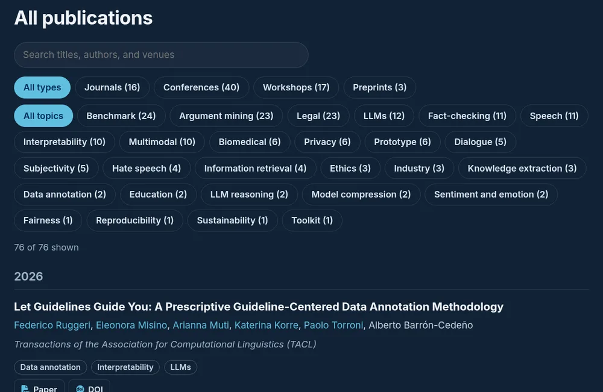

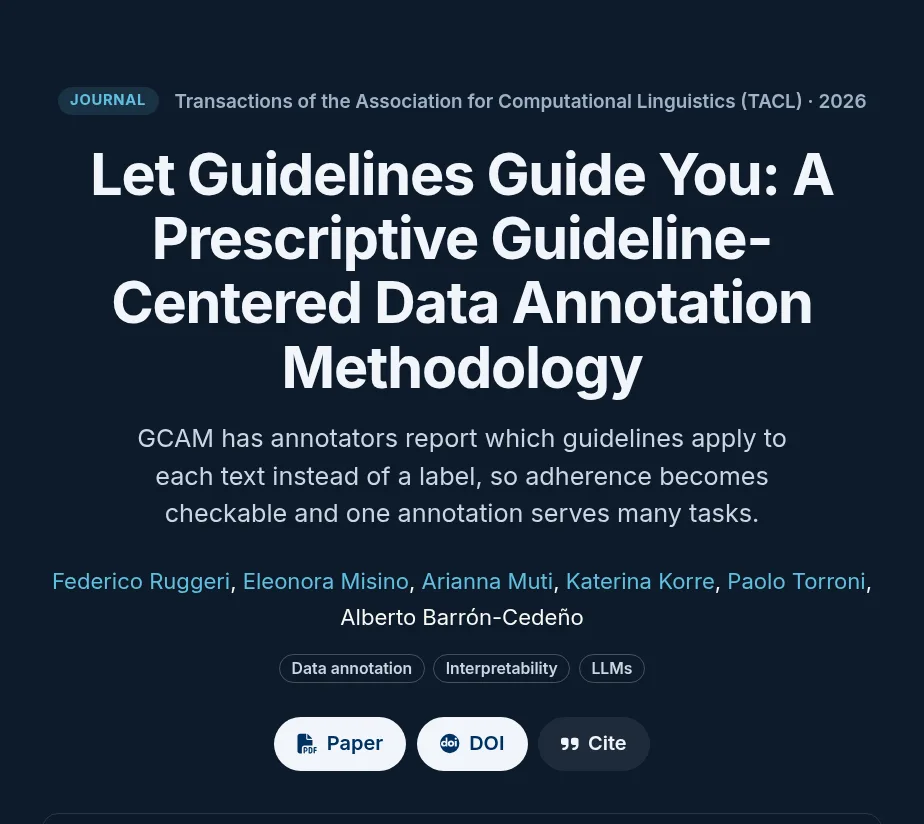

| Where | When |
| --- | --- |
| Publications page, under its year, with filters | Always |
| Its own page `/publication/<slug>/` | Only with a body; otherwise the title opens the DOI, arXiv, PDF, or first link |
| Highlights carousel | Top venue, last four years, among the 12 newest ([rule](#highlights)) |
| Homepage "Latest papers" | Among the 3 newest by `date` |
| News page timeline, as Paper or Preprint | Always, on its `date` |
| Profile of each lab author, and their "Latest topics" | Name spelled as the profile `title` ([rule](#latest-topics-of-people)) |
| A research focus card | Its `focus` names that card |
| "Work done with students" on Work with us | `tags` includes `student publication` |

Not automatic: a news item for the acceptance ([Announce an accepted paper](#announce-an-accepted-paper)).

### Change a publication

Open `content/publication/<slug>/index.md` and edit the field.

| Change | Edit | Consequence |
| --- | --- | --- |
| The paper got a DOI | Add `doi`. Point `url` in `cite.bib` to `https://doi.org/...` | Every arXiv link disappears ([rule](#venue-names-and-arxiv-links)) |
| Preprint became a paper | `categories` to `Journal`/`Conference`/`Workshop`, add `venue_key`, `doi` | Moves to its list; may enter Highlights |
| Wrong venue name | Fix `name` in `data/venues.yaml` | Changes every paper of that venue |
| Different topics | `topics` | Filters, tags, and authors' Latest topics follow |
| Show on a focus card | `focus: [am/fallacies]` | Appears on that card ([rule](#research-focus-current-and-past-work)) |
| Better card figure | Upload `card.svg` and set `card_caption` | Replaces `featured.png` on cards and the page ([rule](#publication-figures)) |

### Find missing publications

This action runs on a local copy of the repository, set up as in [the developers' guide](developers.md).

**Command:** `uv run --locked python scripts/site.py publications --since 2026-01-01`.
`--since` is required. It takes the earliest publication date to compare, as `YYYY-MM-DD`. Use the date of the previous run, or the first day of the year.

**What it does:** for each person in `Members` with an ORCID link (the persistent researcher ID from orcid.org), it asks [OpenAlex](https://openalex.org/), an open catalogue of scholarly works, for the works of that ORCID.
It lists the works that match no publication page, first by DOI and then by title.
A work by several members is listed once, under the first of them in People order.
Datasets, supplementary materials, and preprint copies of a listed paper are left out.

**Steps**

1. Run the command. It needs no account and makes one request for each member.
2. For each listed work, choose one of these:
   - A lab paper: [add the publication](#add-a-publication).
   - Not a paper for the site, such as a deposit, a duplicate record, or a work by another person with the same name: add it to `data/publication_ignore.yaml` with its `id` (the DOI without `https://doi.org/`, or the OpenAlex ID `W...` printed for a work without a DOI) and a `reason`.
3. Run the command again. Only the remaining works are listed.

OpenAlex can miss some workshop papers, and it can take a few weeks to list a new paper.
A member without an ORCID link is skipped, and the command prints a warning.

### Add a news item

**Start:** [create `content/news/short-name-2026/index.md`](https://github.com/nlp-unibo/nlp-unibo.github.io/new/main?filename=content/news/short-name-2026/index.md&value=---%0Atitle%3A%20%22TODO%3A%20Headline%22%0A%23%20YYYY-MM-DD.%20A%20future%20date%20keeps%20the%20item%20hidden%20until%20that%20day.%0Adate%3A%20%22TODO%3A%20YYYY-MM-DD%22%0A%23%20The%20tag%20paper%2C%20special%20issue%2C%20shared%20task%2C%20workshop%2C%20or%20event%20sets%20the%20label.%20Otherwise%3A%20News.%0Atags%3A%0A%20%20-%20news%0Asummary%3A%20%22TODO%3A%20At%20most%20two%20sentences.%22%0A%23%20Optional%2C%20shown%20in%20italics%20under%20the%20title%2C%20such%20as%20a%20venue%20or%20a%20journal%0Avenue%3A%20%22%22%0A%23%20Keys%20from%20data%2Ftopics.yaml%0Atopics%3A%20%5B%5D%0A---%0A%0A-%20%5BTODO%3A%20Link%20text%5D%28https%3A%2F%2FTODO%29%0A)

**Steps**

1. `title` and `date` (a future date hides the item until that day).
2. `summary`: at most two sentences. It is shown whole on the homepage card.
3. `tags`: one tag sets the label (first match wins): `paper` Paper, `special issue` Call for papers, `shared task` Shared task, `workshop` Workshop, `event` Event, anything else News.
4. Optional: `venue` (italic line under the title), `topics` (shown on the News page).
5. Body: a list of links, each becomes a button: `- [Conference website](https://...)`. Upload a PDF to the folder and link it by name.

**Result**

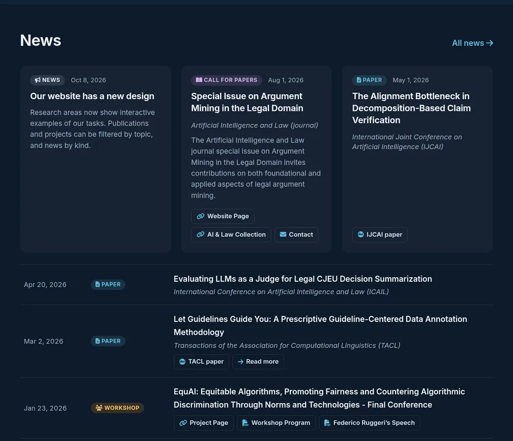

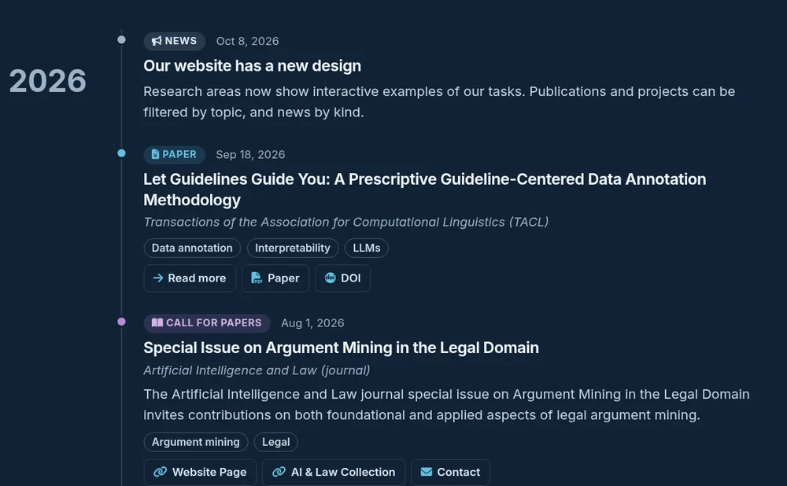

- Homepage News block: the 6 newest news items, the first 3 as cards. Publications never appear there.
- News page: every news item and every publication, newest first, with a kind filter.
- No page of its own: title, summary, and links must make sense alone.

### Announce an accepted paper

Same as [Add a news item](#add-a-news-item), with:

| Field | Value |
| --- | --- |
| `title` | The paper title, exactly |
| `date` | The acceptance day |
| `venue` | The full venue name with acronym, as in `data/venues.yaml` |
| `tags` | `[news, paper]` |
| `summary` | Leave it out: title and venue already say it |
| Body | `- [Paper](https://doi.org/...)` or `- [Read more](/publication/<slug>/)` |

Consequence: the item shows on the homepage. Once the publication page exists with the same title, the News page shows only the publication, so the paper appears once.

### Change a news item

Open `content/news/<slug>/index.md`. Edit `title`, `summary`, or the links. Changing `date` moves the item on both lists.

### Add or update a person

**Start:** [create `content/authors/firstname-lastname/_index.md`](https://github.com/nlp-unibo/nlp-unibo.github.io/new/main?filename=content/authors/firstname-lastname/_index.md&value=---%0A%23%20The%20full%20name%2C%20exactly%20as%20in%20publications.%20The%20folder%20name%20is%20this%20name%20in%20lowercase%20with%20hyphens.%0Atitle%3A%20%22TODO%3A%20Firstname%20Lastname%22%0Afirst_name%3A%20%22TODO%3A%20Firstname%22%0Alast_name%3A%20%22TODO%3A%20Lastname%22%0Asuperuser%3A%20false%0Aorganizations%3A%0A%20%20-%20name%3A%20University%20of%20Bologna%0A%20%20%20%20url%3A%20%22https%3A%2F%2Fwww.unibo.it%2F%22%0A%23%20One%20sentence%2C%20shown%20on%20the%20People%20page%0Abio%3A%20%22TODO%3A%20One%20sentence%20on%20your%20research.%22%0Ainterests%3A%0A%20%20-%20Natural%20Language%20Processing%0Asocial%3A%0A%20%20-%20icon%3A%20envelope%0A%20%20%20%20icon_pack%3A%20fas%0A%20%20%20%20link%3A%20%22mailto%3ATODO%40unibo.it%22%0Aemail%3A%20%22TODO%40unibo.it%22%0Ahighlight_name%3A%20true%0A%23%20Exactly%20one%20of%20Members%2C%20Associate%20Fellows%2C%20External%20Collaborators%2C%20Former%20Members%0Auser_groups%3A%0A%20%20-%20Members%0A%23%20Lower%20values%20appear%20first%20in%20the%20group%0Aweight%3A%20100%0A%23%20Keep%20it%3A%20only%20People%20entries%20get%20a%20profile%20page%0Abuild%3A%0A%20%20render%3A%20always%0A---%0A%0ATODO%3A%20A%20longer%20biography%2C%20in%20a%20few%20sentences.%0A)

**Folder:** the full name in lowercase with hyphens and no accents, matching `title`: `maria-rossi` for `Maria Rossi`.

**Steps**

1. `title` (full name exactly as in publications), `first_name`, `last_name`.
2. `user_groups`: one of `Members`, `Associate Fellows`, `External Collaborators`, `Former Members`.
3. `email` (required except for former members; used by proposal contacts), `bio` (one sentence), `weight` (lower comes first).
4. `social` links: University page `university`/`fas`, email `envelope`/`fas`, website `globe`/`fas`, GitHub `github`/`fab`, LinkedIn `linkedin`/`fab`, Scholar `google-scholar`/`ai`, ORCID `orcid`/`ai` with the `https://orcid.org/...` link. Every member needs the ORCID link for [Find missing publications](#find-missing-publications).
5. Upload one square `avatar.jpg` (or `.png`). Without it, the initials appear.
6. Body: the longer biography for the profile page. Do not set `role` (head and deputy only).

**Result**

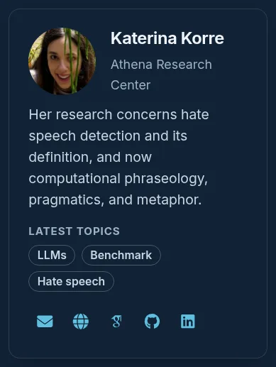


- People page card in the chosen group; profile page `/author/<folder>/` with publications and theses.
- "Latest topics" are computed, never written ([rule](#latest-topics-of-people)).
- The name becomes bold and linked in every author list that spells it exactly as `title`.

**Leaves the lab:** set `user_groups: [Former Members]`. Never delete the folder.

### Add a thesis

**Start:** [create `content/theses/2026firstnamelastname/index.md`](https://github.com/nlp-unibo/nlp-unibo.github.io/new/main?filename=content/theses/2026firstnamelastname/index.md&value=---%0Atitle%3A%20%22TODO%3A%20Thesis%20title%22%0Aauthors%3A%0A%20%20-%20%22TODO%3A%20Student%20Name%22%0A%23%20The%20graduation%20date%2C%20YYYY-MM-DD%0Adate%3A%20%22TODO%3A%20YYYY-MM-DD%22%0Adoi%3A%20%22%22%0Apublication_types%3A%0A%20%20-%20thesis%0Apublication%3A%20%22%22%0Apublication_short%3A%20%22%22%0Aabstract%3A%20%22%22%0Asummary%3A%20%22%22%0A%23%20For%20a%20bachelor%20thesis%2C%20write%20bachelor%20thesis%20here%20and%20Bachelor%20thesis%20in%20categories.%0Atags%3A%0A%20%20-%20master%20thesis%0A%20%20-%20student%0A%23%20The%20AMS%20Laurea%20record%2C%20which%20every%20list%20links%20to%0Aexternal_link%3A%20%22TODO%3A%20https%3A%2F%2Famslaurea.unibo.it%2Fid%2Feprint%2F...%22%0Acategories%3A%0A%20%20-%20Master%20thesis%0A%23%20One%20to%20three%20keys%20from%20data%2Ftopics.yaml%0Atopics%3A%20%5B%5D%0A---%0A)

| Field | Value |
| --- | --- |
| Folder | `<year><name>`, such as `2026mariarossi` |
| `title`, `authors`, `date` | Thesis title, student name, graduation date |
| `categories` | `Master thesis` or `Bachelor thesis` |
| `tags` | `master thesis` and `student` (or `bachelor thesis` and `student`) |
| `external_link` | The AMS Laurea record (or `target: /work-with-us/#student-work` without a public record) |
| `topics` | One to three topic keys |

Result: listed under "Work done with students" on Work with us and on the student's profile. No page of its own.
When the thesis led to a paper, add the paper with the keyword `student publication`.

### Add a research proposal

**Start:** [create `content/proposals/legal/short-name/index.md`](https://github.com/nlp-unibo/nlp-unibo.github.io/new/main?filename=content/proposals/legal/short-name/index.md&value=---%0Atitle%3A%20%22TODO%3A%20Proposal%20title%22%0Adate%3A%20%22TODO%3A%20YYYY-MM-DD%22%0A%23%20One%20sentence%20of%20about%2018%20words%2C%20shown%20at%20the%20top%20of%20the%20opened%20proposal%0Asummary%3A%20%22TODO%3A%20One%20sentence%20that%20says%20what%20the%20proposal%20does.%22%0A%23%20Two%20to%20four%20sentences%2C%20at%20most%2070%20words%2C%20shown%20on%20the%20opened%20card%0Abrief%3A%20%22TODO%3A%20The%20problem%2C%20the%20idea%2C%20and%20what%20a%20student%20would%20do.%22%0A%23%20Folder%20names%20in%20content%2Fauthors%2C%20or%20%7Bname%3A%20Full%20Name%2C%20email%3A%20address%7D%20for%20a%20person%20outside%20the%20lab%0Acontacts%3A%0A%20%20-%20TODO-folder-name%0A%23%20Plain%20words%2C%20not%20abbreviations%0Atags%3A%0A%20%20-%20TODO%20tag%0A---%0A%0A%3C%21--%20The%20body%20is%20optional.%20Without%20it%2C%20the%20opened%20card%20shows%20the%20brief.%20Delete%20all%20sections%20below%20to%20skip%20it.%20--%3E%0A%0A%23%23%20Context%0A%0ATODO%3A%20The%20research%20setting%2C%20with%20every%20technical%20term%20defined%20at%20its%20first%20use.%0A%0A%23%23%20Objective%0A%0ATODO%3A%20What%20the%20proposal%20aims%20at%2C%20in%20one%20or%20two%20sentences.%0A)

**Folder:** `content/proposals/<topic>/<slug>/`.
In the file name, change `legal` to a topic folder of [`content/proposals/`](../content/proposals/), and `short-name` to a short name for the proposal.

**New topic?** Write the new topic name in the file name and finish the proposal. Then add the topic page to the same pull request:

1. On the pull request page, select your branch name, then open `content/proposals/<topic>/`.
2. Select **Add file**, then **Create new file**. Name it `_index.md`, paste the block below, and replace every `TODO`.
3. Select **Commit directly to the branch**. The check stays red until this commit.

```text
---
title: "TODO: Topic title"
summary: "TODO: One sentence on the topic."
---

TODO: A short description of the topic, in a few sentences.
```

| Field | Rule |
| --- | --- |
| `title`, `date` | Proposal title, day added |
| `summary` | One sentence of about 18 words (at most 25), shown at the top of the opened proposal; the search also matches it |
| `brief` | Two to four sentences, at most 70 words, shown on the opened card |
| `contacts` | Folder names in [`content/authors/`](../content/authors/), or `{name: ..., email: ...}` for someone outside the lab |
| Body (optional) | Exactly two sections, `## Context` and `## Objective`, about 120 words (at most 160), no references |
| Figure (optional) | One drawn schema or one image, uploaded to the proposal folder as in [Add images and files](#add-images-and-files) |

To show the figure, add one line at the end of the body, with a caption that says what the figure shows and where it comes from:

```text


```

Use `svg` for a drawn schema, which follows the site colors; ask the maintainer to draw one.
Use `figure` for an image you may publish.
A figure needs the body: without it, the opened card shows only the brief.

**Result**

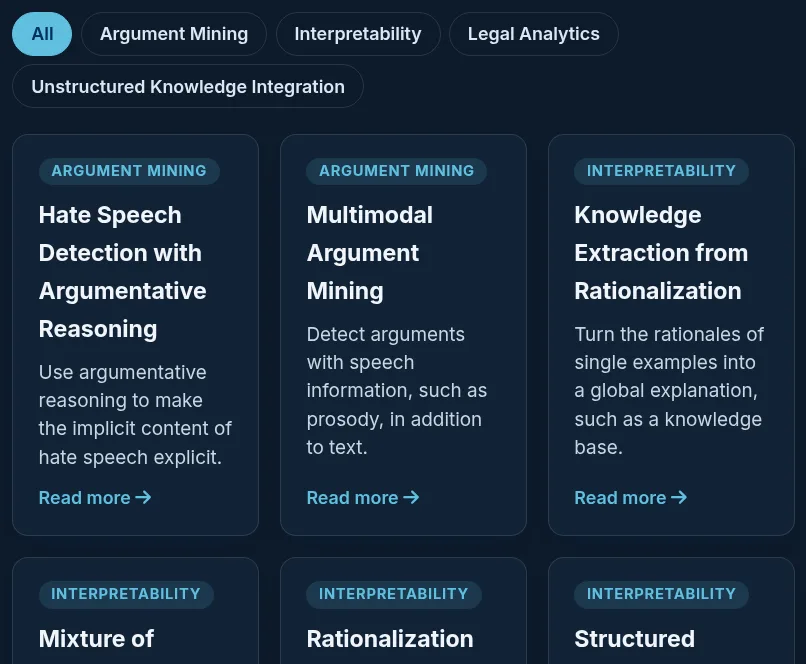

- A row on Work with us under its topic heading, with its title and the faces of its contacts. Opening it shows the summary, the contacts, **Choose this proposal**, and the body or brief.
- A student who chooses it writes to its contacts.

### Add a project

**Start:** [create `content/projects/acronym/index.md`](https://github.com/nlp-unibo/nlp-unibo.github.io/new/main?filename=content/projects/acronym/index.md&value=---%0A%23%20End%20with%20the%20acronym%20in%20brackets%3A%20it%20becomes%20the%20card%20headline.%0Atitle%3A%20%22TODO%3A%20Full%20Project%20Name%20%28ACRONYM%29%22%0A%23%20The%20project%20start%2C%20YYYY-MM-DD%0Adate%3A%20%22TODO%3A%20YYYY-MM-DD%22%0A%23%20One%20or%20more%20keys%20from%20data%2Ftopics.yaml%0Atopics%3A%0A%20%20-%20TODO-topic%0Asummary%3A%20%22TODO%3A%20One%20sentence%20on%20the%20project.%22%0A%23%20The%20project%20website%0Aexternal_link%3A%20%22https%3A%2F%2FTODO%22%0A%23%20International%20project%20or%20National%20project%0Acategories%3A%0A%20%20-%20National%20project%0A---%0A)

| Field | Rule |
| --- | --- |
| `title` | Ends with the acronym in brackets: `Argument Mining In Covid-19 Articles (AMICA)` |
| `date` | Project start |
| `summary` | One sentence |
| `external_link` | Project website |
| `topics` | One or more topic keys |
| `categories` | `International project` or `National project` |

**Result**

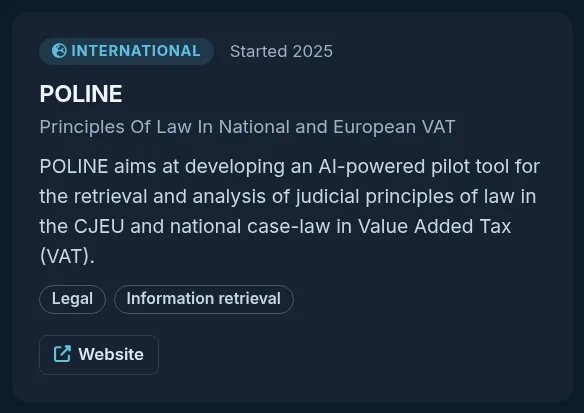

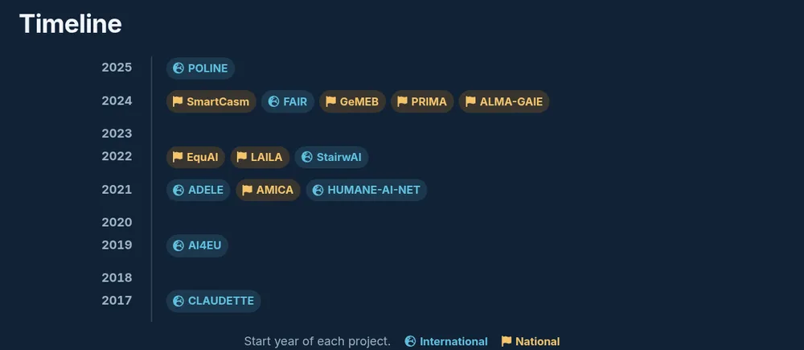

- A card and a timeline entry on Projects; the three newest also appear in a Work with us step.

### Add a tool

**Start:** [create `content/tools/tool-name/index.md`](https://github.com/nlp-unibo/nlp-unibo.github.io/new/main?filename=content/tools/tool-name/index.md&value=---%0Atitle%3A%20%22TODO%3A%20Tool%20name%22%0A%23%20The%20first%20public%20release%2C%20YYYY-MM-DD.%20It%20orders%20the%20Tools%20page.%0Adate%3A%20%22TODO%3A%20YYYY-MM-DD%22%0A%23%20One%20or%20more%20keys%20from%20data%2Ftopics.yaml%0Atopics%3A%0A%20%20-%20toolkit%0A%23%20Web%20service%2C%20Web%20demo%2C%20or%20Python%20library%0Akind%3A%20Python%20library%0Asummary%3A%20%22TODO%3A%20What%20the%20tool%20does%2C%20in%20at%20most%20two%20sentences.%22%0A%23%20The%20tool%20website%0Aexternal_link%3A%20%22https%3A%2F%2FTODO%22%0A%23%20Optional%3A%20remove%20the%20%23%20to%20use%20a%20line.%0A%23%20schema%3A%20schema.svg%0A%23%20caption%3A%20%22What%20the%20schematic%20shows%20and%20where%20it%20comes%20from.%22%0A%23%20demo%3A%20%22https%3A%2F%2F...%22%0A%23%20code%3A%20%22https%3A%2F%2Fgithub.com%2Fnlp-unibo%2F...%22%0A%23%20publication%3A%20folder-name-in-content-publication%0A%23%20license%3A%20MIT%0A%23%20package%3A%20pypi-name%0A---%0A)

Only systems that readers can use today (service, demo, package). A demo built only for a paper is a prototype: give its publication the `prototype` topic instead.

| Field | Rule |
| --- | --- |
| `title`, `date`, `summary` | Name, first release (orders the page), at most two sentences |
| `external_link`, `topics` | Website, topic keys |
| `kind` | `Web service`, `Web demo`, or `Python library` |
| Optional | `demo`, `code`, `publication` (a publication folder name), `license`, `package` (PyPI), `schema` and `caption` |

**Result**

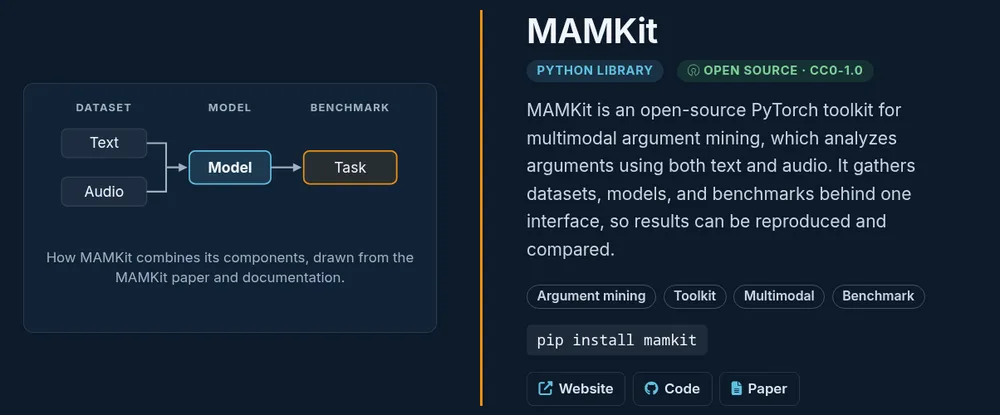

### Add a research focus card

A focus card is one lab topic inside a research area, shown in the "Our focus" carousel.

**File:** `content/research/<area>/index.md` (areas: `am`, `legal`, `speech`).

**Steps**

1. Add an entry under `focus`:

   ```yaml
   focus:
     - key: fallacies              # unique in this area, lowercase
       title: "Argumentative fallacies"
       icon: exclamation-triangle  # Font Awesome 5 solid
       summary: "At most two sentences for the card."
       description: "Two to four sentences for the box below the carousel."
   ```

2. In each related publication, add `focus: [am/fallacies]` (`<area>/<key>`).
3. Give the newest paper a `card.svg` and a `summary`, because the card shows them.

**Result**

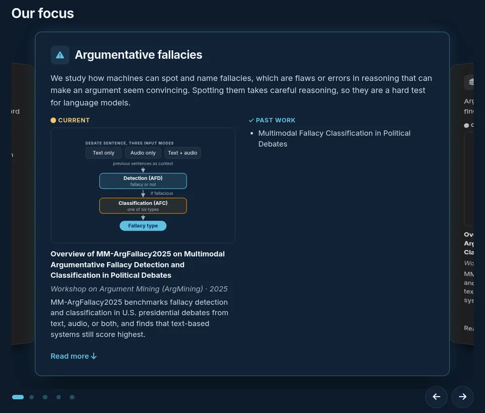

- Current: the newest linked paper of the last two years, with its schema, venue, and summary. Past work: the others, by title ([rule](#research-focus-current-and-past-work)).
- The topic title also appears on the homepage Research card of the area.

### Add a research area

**Start:** [create `content/research/short-name/index.md`](https://github.com/nlp-unibo/nlp-unibo.github.io/new/main?filename=content/research/short-name/index.md&value=---%0Atitle%3A%20%22TODO%3A%20Research%20area%20name%22%0Adate%3A%20%22TODO%3A%20YYYY-MM-DD%22%0Atags%3A%0A%20%20-%20research%0Asummary%3A%20%22TODO%3A%20One%20sentence%20on%20the%20area.%22%0A%23%20A%20Font%20Awesome%205%20solid%20icon%20name%2C%20such%20as%20comments%20or%20balance-scale%0Aicon%3A%20comments%0A%23%20Position%20on%20the%20homepage%20and%20the%20Research%20page.%20Lower%20comes%20first.%0Aweight%3A%2010%0A%23%20At%20most%2012%20words%2C%20shown%20on%20the%20homepage%20card%0Atagline%3A%20%22TODO%3A%20Tagline%22%0A%23%20dots%2C%20graph%2C%20tokens%2C%20or%20wave%0Acover_pattern%3A%20dots%0Afields%3A%0A%20%20-%20key%3A%20first-field%0A%20%20%20%20title%3A%20%22TODO%3A%20Block%20title%22%0A%20%20%20%20icon%3A%20search%0A%20%20%20%20question%3A%20%22TODO%3A%20The%20question%20this%20family%20of%20tasks%20answers.%22%0A%20%20%20%20summary%3A%20%22TODO%3A%20One%20or%20two%20sentences.%22%0A%20%20%20%20tasks%3A%0A%20%20%20%20%20%20-%20name%3A%20%22TODO%3A%20Task%20name%22%0A%20%20%20%20%20%20%20%20text%3A%20%22TODO%3A%20Given%20an%20input%2C%20the%20task%20is%20to%20produce%20an%20output.%22%0A%23%20Publications%20join%20a%20topic%20through%20their%20own%20focus%20field.%0Afocus%3A%0A%20%20-%20key%3A%20first-topic%0A%20%20%20%20title%3A%20%22TODO%3A%20Topic%20title%22%0A%20%20%20%20icon%3A%20comments%0A%20%20%20%20summary%3A%20%22TODO%3A%20At%20most%20two%20sentences.%22%0A%20%20%20%20description%3A%20%22TODO%3A%20Two%20to%20four%20sentences%20for%20a%20reader%20outside%20the%20field.%22%0A---%0A%0A%23%23%20What%20is%20TODO%3F%0A%0ATODO%3A%20Define%20the%20research%20area%20in%20three%20or%20four%20plain%20sentences.%0A)

A research area is a large page with interactive examples. Agree on it with the maintainer, then copy `content/research/am/index.md` and replace its content.

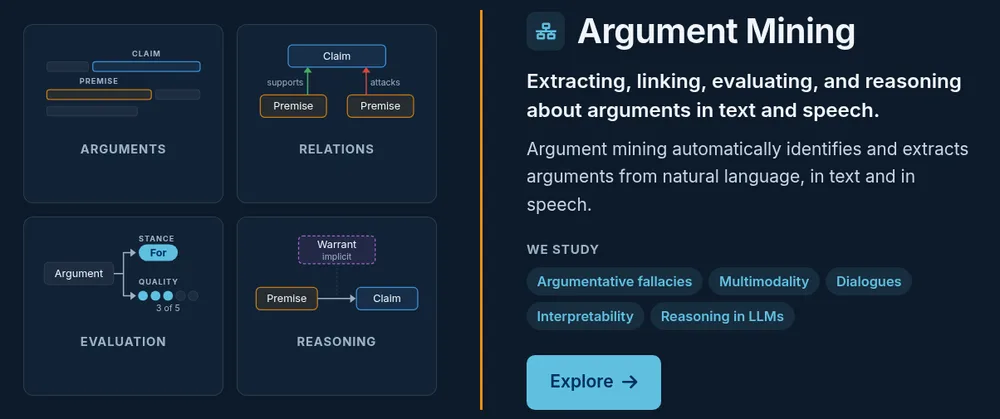

Main fields: `title`, `summary`, `tagline` (at most 12 words), `icon`, `weight` (order), `definition`, `overview` (concept blocks with schemas), `fields` (task families), `focus` (focus cards), `views` (interactive examples, copied from an existing area).

### Edit the homepage, the menu, or a page introduction

| Edit | File | What you can change |
| --- | --- | --- |
| Homepage | [edit `content/_index.md`](https://github.com/nlp-unibo/nlp-unibo.github.io/edit/main/content/_index.md) | Hero texts (`eyebrow`, `title`, `text`), block titles, News `count` (6) and `featured` (3), Latest papers `count` (3) |
| Menu | [edit `config/_default/menus.yaml`](https://github.com/nlp-unibo/nlp-unibo.github.io/edit/main/config/_default/menus.yaml) | `name`, `url`, `weight` (lower first), `parent`. The menu must fit one line at 1280 px |
| Page introduction | `intro` in `_index.md` of Research, Projects, Tools, News, or `content/people/index.md` | One sentence, at most 25 words |


Ask the maintainer to review homepage and menu changes.

### Edit the Work with us page

**Start:** [edit `content/work-with-us/index.md`](https://github.com/nlp-unibo/nlp-unibo.github.io/edit/main/content/work-with-us/index.md)

| Part | Field |
| --- | --- |
| Default recipients | `contacts`: author folder names |
| Path cards | `paths`: `key`, `label`, `summary`, `icon`, `title`, `who`, `what` |
| Steps of a path | `steps`: `title`, `text`, optional `show`: `proposals`, `projects`, or `contact` |
| Email form | `form`: `subject` (may use `{field}`), `fields` |

Form field options:

| Option | Effect |
| --- | --- |
| `type: text`, `textarea`, `select` | Plain field, long text, list of `options` |
| `type: number` | Counter, whole numbers from 0 |
| `type: month` | Month and year, never before this month, written as "March 2027" |
| `required: true` | Email button stays disabled until filled |
| `when: {field: value}` | Shown only while another field has that value |
| `when_more: {exams: 0}` | Shown only while a number field is above the value |
| `after: [{field: start, months: 6, message: "..."}]` | Blocks the email and shows the message until the month is at least that many months after another (`0` = not before) |
| `options: proposals` | Lists the research proposals |

**Result**

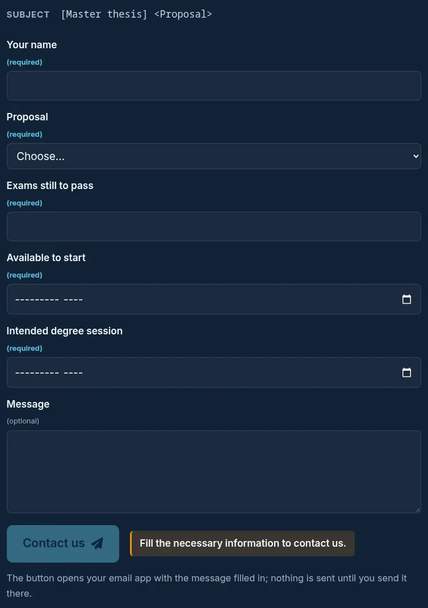

The form opens the visitor's email app; nothing passes through the site. Ask the maintainer to review changes.

### Add images and files

1. On the pull request page, select your branch name, then open the page folder.
2. **Add file**, **Upload files**, drag the files, **Commit directly to the branch**.
   For a text page: **Add file**, **Create new file**, type its name, paste the text, **Commit directly to the branch**.

Rules: at most 5 MiB each, lowercase names with hyphens and no spaces, exact names (`avatar.jpg`, `featured.png`, `card.svg`), only files you may publish.

### Hide, remove, or reorder

| Goal | How |
| --- | --- |
| Hide for a while | Add `draft: true` |
| Remove for good | Delete the whole folder in one branch; remove references to it (the check names them) |
| Person who left | `user_groups: [Former Members]`, never delete |
| Replace an image | Upload a file with the same name |
| Reorder people or areas | Change `weight` (lower first) |
| Reorder publications, news, projects, tools | Change `date` (newest first) |

## Site rules

The site chooses some content by itself. Each rule says what it does, where it lives, and how to change it.
Rules in `layouts/` are code: ask the maintainer. Rules in `data/` or `content/` can be changed by editors.

### Highlights

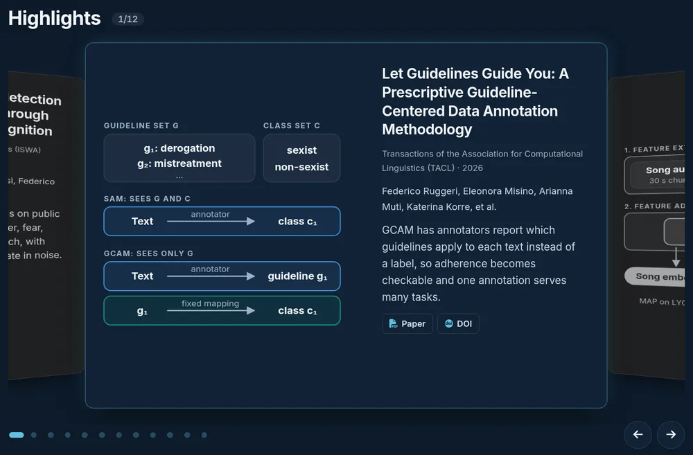

| Item | Rule |
| --- | --- |
| Shows | The 12 newest papers of the last four calendar years from a top venue |
| Top venue | ICORE A* or A conference, SJR Q1 journal, or `top: true` in `data/venues.yaml` |
| Excluded | Workshops, industry and demo tracks, preprints (no rank) |
| Tie | Same date: a journal before a conference; same kind and date: list order |
| Change the ranks | `data/venues.yaml` (`rank`, `top`), editors |
| Change 12, four years, the classes, the tie | `layouts/publication/section.html`, maintainer |

### Latest topics of people

| Item | Rule |
| --- | --- |
| Shows | Up to three topics on People cards and profiles |
| Counts | `topics` of the person's publications of the last two years |
| Excluded | Workshop papers, papers tagged `shared task`, the `prototype` topic |
| Tie | The topic of more papers with the person as first author |
| Change the topics of a paper | `topics` of the publication, editors |
| Change the window, the exclusions, the tie | `layouts/_partials/lt/person-topics.html`, maintainer |

### Research focus: Current and Past work

| Item | Rule |
| --- | --- |
| Current | The newest paper whose `focus` names the card, dated within the last two years |
| Past work | Every other linked paper |
| Card figure | `card.svg` or `card.png` only, never a figure from the paper |
| Change the window | `layouts/research/single.html`, maintainer |

### Homepage blocks

| Block | Shows | Change |
| --- | --- | --- |
| Research | One card per area, by `weight` | Area `weight` |
| News | 6 newest news items, first 3 as cards; summaries in full | `count`, `featured` in `content/_index.md` |
| Latest papers | 3 newest publications by `date`, preprints included | `count` in `content/_index.md` |

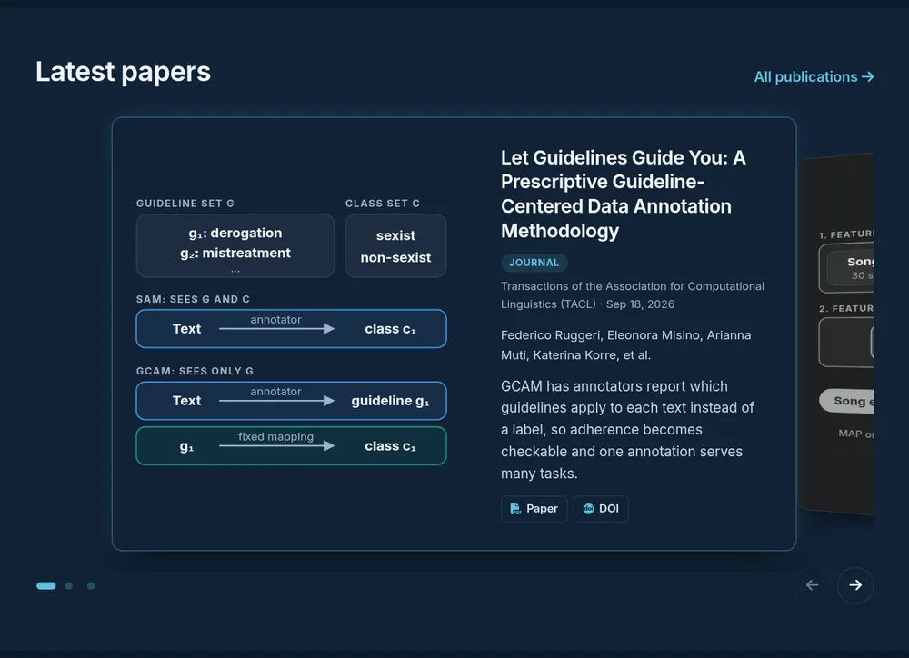

### News page

| Item | Rule |
| --- | --- |
| Shows | Every news item and every publication, newest first, grouped by year |
| Duplicates | An acceptance news item whose title equals a publication title is hidden |
| Labels | From news `tags` (see [Add a news item](#add-a-news-item)); publications are Paper or Preprint |
| Change | `layouts/news/list.html`, maintainer |

### Venue names and arXiv links

| Item | Rule |
| --- | --- |
| Venue shown | `name` of `venue_key` in `data/venues.yaml`: "Full name (ACRONYM)", or the full name alone when there is no established acronym |
| Preprint | "Preprint", or "arXiv preprint" when `publication` names arXiv |
| arXiv link | Hidden on every list and page once the paper has a `doi` |
| Change | Venue names: `data/venues.yaml`, editors. Link rule: `layouts/_partials/lt/pub-meta.html`, maintainer |

### Topics and keywords

| | Topics | Keywords |
| --- | --- | --- |
| Field | `topics` | `tags` |
| Shown | Neutral tags on cards, pages, filters | Publication page only |
| List | Closed: `data/topics.yaml` | Vocabulary: `data/tags.yaml` |
| New one | Add a key and `label`, maintainer review | Add it to `data/tags.yaml` in the same pull request |
| Check | Unknown key fails | Unknown keyword fails; a near-duplicate names the existing one |

All topics share one style; a topic has no colour of its own.

### Publication figures

| Place | First available |
| --- | --- |
| Publication page teaser | `teaser.mp4`, then `card.svg`, then `featured.png`, then a pattern |
| Cards (carousels, lists) | `card.svg`, then `card.png`, then `featured.png` |
| Research focus card | `card.svg`, then `card.png` |

Reuse a figure from a paper only when its source is openly licensed (arXiv, ACL Anthology, CEUR-WS), and credit it in `image: caption:`.

### Work with us forms

| Form | Checks |
| --- | --- |
| Master thesis | Exams still to pass: whole number from 0. End of remaining exams: asked when at least one exam is left. Degree session: at least six months after the start, not before the end of the exams. The start may precede the last exam |
| Every form | Required fields filled; recipients from the chosen proposal, else the path contacts |
| Change | The `form` of the path in `content/work-with-us/index.md`, editors with maintainer review |

## When the check fails

The check runs two scripts on every commit of a pull request to `main`:

| Script | What it verifies |
| --- | --- |
| `scripts/test_site.py` | The checker itself. It fails only after a change to the code: ask the maintainer |
| `scripts/site.py check` | The front matter of every page, the content rules in the table below, every template, and a full build of the site |

A pull request merges only with a green check, and `main` accepts changes only through a pull request.

Select **Details** next to the red cross, open **Validate content and production build**, and read the lines that start with a file name.

| Message | Meaning and fix |
| --- | --- |
| `required field '...' is empty` | The named field is missing or empty. Add it to the front matter |
| `contains TODO marker` | A `TODO` text from the template is still there. Replace it, or add `draft: true` until the page is ready |
| `contains example domain` or `contains example email` | A template address such as `example.org` or `test@example.org` is still there. Replace it with the real one |
| `contains Lorem ipsum` or `contains publication boilerplate` | Placeholder text from an old template is still there. Replace it |
| `categories must be exactly one of ...` | The `categories` value is missing, misspelled, or repeated. Copy one allowed value from the message |
| `venue_key '...' is not defined in data/venues.yaml` | Set `venue_key` to a key of `data/venues.yaml`, or add the venue there |
| `venue rank '...' does not fit a ... paper` | The venue rank belongs to another kind of venue. Check `venue_key` and `categories`, or fix `rank` in `data/venues.yaml` with the table in [Add a publication](#add-a-publication) |
| `venue '...' has rank '...'` | A rank in `data/venues.yaml` is misspelled. Use one value of the table in [Add a publication](#add-a-publication) |
| `summary has ... words`, `brief has ... words`, `body has ... words` | A proposal text is too long. Shorten it to the limit in the message |
| `contact '...' is not a folder in content/authors` | Write the folder name of the person, such as `federico-ruggeri`, or `{name: ..., email: ...}` for someone outside the lab |
| `body sections are ...` | A proposal body has other headings. Use exactly `## Context` and `## Objective` |
| `publication_types must be exactly one of ...` | Use one value from the message, as described in [Add a publication](#add-a-publication) |
| `user_groups must be exactly one of ...` | Use exactly one of `Members`, `Associate Fellows`, `External Collaborators`, or `Former Members` |
| `author slug must be '...'` | A person's folder name does not match their `title`. Create the folder with the name the message shows |
| `authors term '...' conflicts with '...'` | The same person is written in two ways, for example with and without an accent. Use the spelling of their profile |
| `tags term '...' conflicts with '...'` | The same tag is written in two ways, for example `semeval` and `SemEval`. Use the spelling of the existing tag |
| `topic '...' is not defined in data/topics.yaml` | Use a key from `data/topics.yaml`, listed in [Add a publication](#add-a-publication) |
| `email link '...' must start with mailto:` | Write email links as `[Name](mailto:name@unibo.it)` |
| `local link '...' does not exist` | A link points to a missing file. Check the spelling and capitals, and upload the file to the page folder |
| `invalid slug '...'` | The folder name contains capitals, spaces, or other characters. Use lowercase letters, numbers, and hyphens only |
| `missing page index` | The folder has no `index.md` (or `_index.md` for a person or a proposal topic). Check the file name |
| `pages must be folders with an index.md` | A page was saved as `name.md` directly in a section. Save it as `name/index.md` instead |
| `... MiB exceeds 5 MiB asset limit` | Compress the image or PDF, then upload it again |
| `missing YAML front matter between --- lines` | The file must start with a `---` line. Restore it |
| `missing closing YAML delimiter` | The second `---` line is missing. Restore it |
| `front matter must be a YAML mapping` | The front matter is not a list of `name: value` lines. Compare it with the template |
| `repeated key ...` | The same field appears twice in the front matter. Keep one of them |
| A YAML error with a line number | The front matter layout is broken. Check tabs, indentation, quotes, and both `---` lines near that line |
| `fields key '...' is missing or repeated` (also `focus` and `views`) | Give every block of a research area its own `key` |
| `focus topic '...' is not a <area>/<key> of content/research` | A publication `focus` entry names a missing area or topic key. Fix it to match a `key` under `focus` in `content/research/<area>/index.md` |
| `view '...': ...` | An interactive view of a research area is inconsistent. Compare it with the view you copied, or ask the maintainer |
| `publication "..." not found for ...` | A tool names a missing publication folder in `publication`. Fix the folder name |
| `tool schema "..." not found in ...` | A tool names a schematic file you did not upload. Upload it, or remove `schema` |
| `contact "..." is not in content/authors` | A proposal or the Work with us page names a contact folder that does not exist. Fix the folder name |
| `author "..." has no email` | A contact's profile has no `email`. Add it, or choose another contact |
| `contact ... needs a name and an email` | A contact outside the lab needs both `name` and `email` |
| `tag '...' is not in data/tags.yaml; use the existing '...'` | The keyword is a variant of an existing one. Use the existing keyword |
| `tag '...' is not in data/tags.yaml; add it there if it is a new keyword` | Add the keyword to `data/tags.yaml`, or pick an existing one |
| `data/tags.yaml: '...' and '...' look like the same keyword` | Keep one of the two in `data/tags.yaml` and in the publications |

Warnings (the check still passes): `future publication date ...` (hidden until that date), `missing cite.bib` (no Cite button).

No message, but missing: `draft: true` left, a future date, a wrong `categories` value, a file name that differs in capitals, or the deployment still running (wait, then reload without cache).
When stuck, comment on the pull request and ask the maintainer.

## Publication blog pages

A publication may have a body: a page that explains the paper to a reader outside the field.

| Item | Rule |
| --- | --- |
| For | Papers in the Highlights or shown as Current on a research focus card. Others link to the DOI or arXiv record, though anyone may still write a body |
| Sections | `## Research setting`, `## Motivation`, `## Approach`, `## Results`, `## Takeaways` |
| Teaser | `card.svg` with `card_caption` |
| Components | `figure`, `svg`, `gap`, `pipeline`, `stages`, `numbers`, `bars`, `annotate`, `takeaways` (examples in `archetypes/`) |
| Rules | Every statement from the paper; no citations; no number before its context |

Ask the maintainer for the writing brief before you start. Without a body, the title opens the paper.
